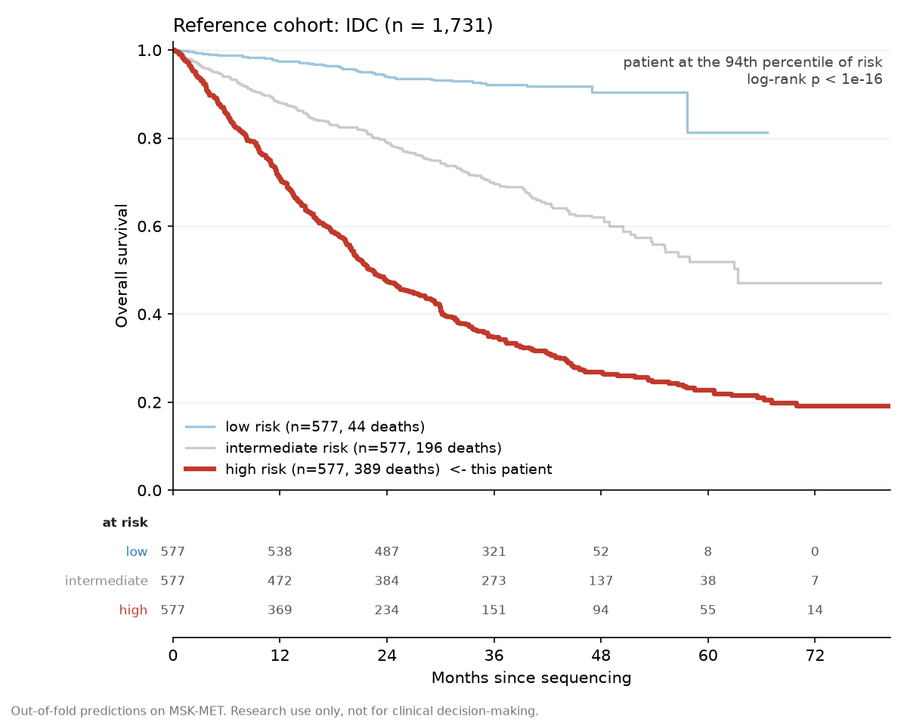

# mtb-survival-model

An overall survival risk model trained on MSK-MET, served to a Molecular Tumor
Board portal as a stateless HTTP service.

The model is deliberately ordinary. Pan-cancer survival prediction is a
well-covered problem and a gradient-boosted Cox model is a defensible baseline,
not a research contribution. What this repository is actually for is the path
from a model to a clinician's screen: a feature schema that cannot drift
between training and serving, missing data that stays missing instead of
becoming zero, a percentile against a named reference cohort, attributions in
clinical language, and a service that retains nothing.

It is used by a tab in [`mtb-clinical-tools`](https://github.com/shaizalyasin/mtb-clinical-tools),
deployed by [`mtb`](https://github.com/shaizalyasin/mtb). Neither needs a fork
of cBioPortal.

## Status

The end-to-end slice works: download, verify, train, serve a real patient
fetched live from a portal, render the figure.

| | |
| --- | --- |
| Cohort | `msk_met_2021`, 24,561 patients after exclusions |
| Features | 752 (8 clinical, 54 cancer type, 442 mutation, 174 amplification, 74 deletion) |
| Test C-index | **0.7126** |
| Out-of-fold C-index | 0.7040 |
| Train C-index | 0.7336 |

Still to do: hyperparameter tuning, the four-arm ablation, the full metric
suite (time-dependent AUC, integrated Brier score), and `report.md`.

## The number to compare against, and why ours is lower

This reproduces the feature set of [Mestrallet, *Onco* 2025](https://doi.org/10.3390/onco5010008),
which used the same cohort and reported a C-index of 0.76.

That 0.76 is not our target, for two reasons that are both deliberate:

1. It was measured on `msk_met_2021` **merged with `msk_ch_2020`**, n = 16,603,
   with **treatment** as a feature. Treatment is not knowable for a patient at
   the moment of sequencing, so it cannot go in a model that has to score a
   newly sequenced patient.
2. Its strongest single predictor is **metastasis count**. That is accumulated
   over the patient's whole disease course. Relative to the sequencing
   timepoint it is future information, and a model using it looks excellent and
   predicts nothing you did not already know.

So the gap between 0.71 and 0.76 is the point, not a shortfall. Quantifying it
is what the planned ablation is for:

```
1. clinical only (age, sex, cancer type, sample type)
2. genomic only  (mutations, CNA, TMB, MSI, FGA)
3. full model    (what we serve)
4. full + MET_SITE_COUNT   <- never served, exists only to measure the gap
```

Arm 4 is not a model anyone should deploy. It is a measurement.

## What the model is allowed to know

Every feature is retrievable for a new patient in one round trip at the time of
sequencing: age, sex, sample type, OncoTree code, TMB, MSI score, fraction of
genome altered, mutated genes, amplified and deeply deleted genes.

Explicitly excluded, with the reason recorded in [`src/load.py`](src/load.py):
`MET_COUNT`, `MET_SITE_COUNT`, `IS_DIST_MET_MAPPED`, `METASTATIC_SITE`,
`AGE_AT_EVIDENCE_OF_METS`, the 21 `DMETS_DX_*` site flags, and treatment.

## Two things found in the data that change the result

**Off-panel genes are untested, not wild type.** MSK-MET mixes three IMPACT
panel versions, and 32% of patients were sequenced on a panel smaller than the
largest. Coding a gene that was never on a patient's panel as "no mutation
found" asserts a negative result nobody measured. Those cells are NaN instead,
which is 9.35% of all gene cells. Panel definitions are not in the study
tarball and are fetched from the cBioPortal API, then cached.

**Attribute names differ between studies.** The flat file calls it `FGA` while
the REST API calls it `FRACTION_GENOME_ALTERED`. The demo study uses `GENDER`
and `CURRENT_AGE_DEID` where the training study uses `SEX` and
`AGE_AT_SEQUENCING`. The alias table in [`src/features.py`](src/features.py)
handles the names, but `CURRENT_AGE_DEID` is age **today**, not age at
sequencing, so for a sample sequenced years ago it runs high. That difference
is reported in the response as an `input_caveats` entry rather than absorbed
silently.

## Running it

```bash
make setup      # virtualenv and pinned dependencies
make train      # downloads 34 MB, trains, writes artifacts/, a few minutes
make test       # 14 tests
make demo       # scores a live patient from a study the model never saw
make serve      # http://localhost:8000
```

The artefacts are committed (under 1 MB), so a clone can serve without
retraining. `make artifact-size` fails the build if that stops being true.

```bash
docker build -t mtb-survival-model .
docker run --rm -p 8000:8000 mtb-survival-model
```

## What the service is, and is not

It is **stateless**. No database, no session store, no logging of payloads,
nothing written after startup. Patient data exists only for the lifetime of a
request. That is not housekeeping: it turns the data protection question from
"we store patient data, here are our controls" into "we retain nothing", which
is true by construction rather than by policy.

It **never calls cBioPortal**. The caller sends payloads it already fetched
under the end user's own portal session. The service holds no credentials and
cannot be used to read a patient the user is not entitled to see. Giving it a
study and sample id to go and fetch would undo this, so the endpoint does not
accept them.

| endpoint | |
| --- | --- |
| `POST /predict` | the three payloads for one sample, returns score, percentile, attributions |
| `GET /reference-km/{oncotree_code}` | out-of-fold KM curves by tertile, for the tab to draw |
| `GET /cancer-types` | codes with a reference cohort large enough to quote against |
| `GET /model-card` | training provenance and the disclaimer |
| `GET /health` | |

The percentile is the primary output. A raw Cox score means nothing on its own.



## Limitations

- **Immortal time.** Patients had to survive to be sequenced and enrolled.
  `OS_MONTHS` is measured from the date of sequencing, confirmed both from the
  study's data dictionary and by reconstructing the interval from the age
  columns, so features and time origin coincide. Selection into the cohort is
  still conditioned on surviving to that point.
- **Single institution, single panel family.** Trained entirely on MSK-IMPACT.
  Transferring to another site's assay is not free: the overlapping gene set
  has to be checked and genes outside it set to missing, not zero. The
  machinery for that exists but has only been exercised on IMPACT panels.
- **No treatment data.** This predicts prognosis under whatever care the MSK
  cohort received. It is not a treatment-effect model and must not be read as
  one.
- **Cancer type dominance.** A pan-cancer survival model largely learns the
  diagnosis. How much the genomics adds on top is exactly what the ablation
  measures, and that number is not in yet.
- **Not prospectively validated.** Research use only, not for clinical
  decision-making. A model whose output informs treatment decisions is likely
  to fall under MDR, which is a question to settle before this is used for
  anything beyond research.

## Layout

```
src/download.py    fetch and extract the datahub tarball
src/load.py        parse flat files, verify column names, check the OS anchor
src/panels.py      gene panel membership, so untested genes are not wild type
src/features.py    the one feature builder, used by training AND serving
src/train.py       train, out-of-fold reference cohort, Breslow baseline
src/inference.py   single patient: score, percentile, attributions, KM
src/evaluate.py    figures and metrics
src/api.py         FastAPI
src/demo_patient.py  score a live patient end to end
artifacts/         model, schema, reference cohort (committed)
```

## Licensing

Code is AGPL-3.0, consistent with cBioPortal and the rest of the project.

Two artefacts are derived from MSK-MET, which is published under ODbL v1.0, a
share-alike data licence, and are distributed under that licence instead. See
[`artifacts/DATA_LICENCE.md`](artifacts/DATA_LICENCE.md) for the split and the
required attribution.
